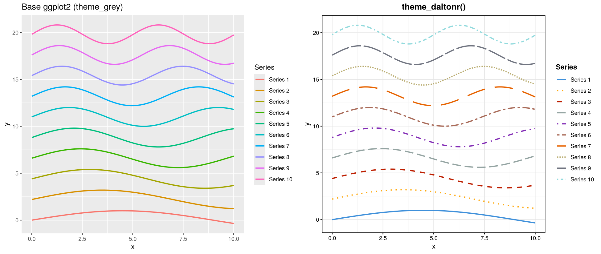
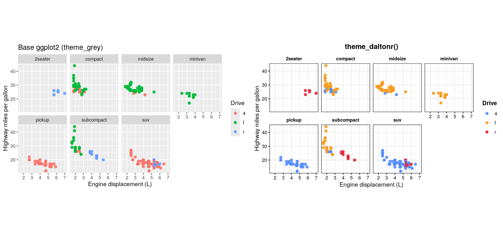
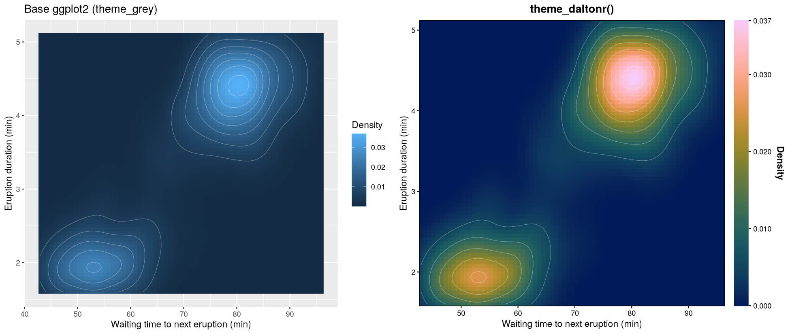
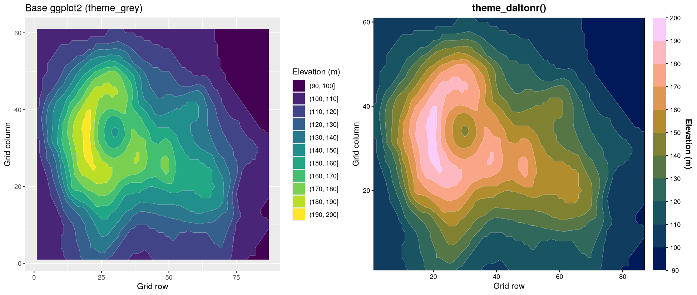

# daltonr

An opinionated modern scientific style ggplot2 theme with CVD-friendly (colour-vision deficiency) palettes built in.

- Petroff colour palettes for categorical data.
- Fabio Crameri's scientific colour maps (default `batlow`) for continuous data.
- viridis and cividis colour maps for continuous data.
- White panel, black axes with outside ticks, and grey grid lines
- Borderless white facet strips
- Optional modern scales with `set_scales = TRUE` (default)
- Optional no axis padding on raster/filled-contour plots with `auto_coord = TRUE` (default)
- Optional automatic `linetype` for line plots (default)

Add `theme_daltonr()`, or call `use_daltonr()` to make it the session default.
Categorical Petroff colour palettes are chosen automatically by number of groups.

## Installation

```r
# from the package directory
R CMD INSTALL .
# or
devtools::install("/path/to/daltonr")
```

## Usage

```r
library(ggplot2)
library(daltonr)

use_daltonr()   # make theme_daltonr() the session default


ggplot(mpg, aes(displ, hwy, colour = class)) +
  geom_point(size = 2) +
  theme_daltonr()   # or add to plots at the end
```

## Theme

The theme's default options:

```r
theme_daltonr(
  base_size = 11,
  base_family = "sans",
  set_scales = TRUE,
  auto_coord = TRUE,
  auto_linetype = TRUE,
  grid = "both",
  border = TRUE,
  axis_ticks = "outside",
  title_align = "center",
  na.value = "grey80",
  colourbar = "fill",
  colourbar_title = "right"
)
```

### Categorical Plots

Line plots get both colour and 10 linetypes automatically [`daltonr_linetypes`]:





Give the colour and linetype scales the same `name` (or use `labs()`) to merge the legends.

### Raster and Filled-Contour Plots

Raster and filled-contour plots fill the axis frame automatically (`coord_cartesian(expand = FALSE)` by default).

Use `auto_coord = FALSE` to `theme_daltonr()` to keep ggplot2's default axis padding.





Every colour map works on both continuous and discrete scales:

```r
volcano_df <- data.frame(
  x = rep(seq_len(ncol(volcano)), each = nrow(volcano)),
  y = rep(seq_len(nrow(volcano)), ncol(volcano)),
  height = as.vector(volcano)
)

# continuous colourbar
ggplot(volcano_df, aes(x, y, fill = height)) +
  geom_raster() +
  scale_fill_daltonr(palette = "tokyo")

# diverging map with midpoint
ggplot(volcano_df, aes(x, y, fill = height - mean(volcano))) +
  geom_raster() +
  scale_fill_daltonr(palette = "broc", midpoint = 0)

# viridis and cividis
ggplot(volcano_df, aes(x, y, fill = height)) +
  geom_raster() +
  scale_fill_daltonr(palette = "viridis")

# filled contours: discrete scale with a stepped colourbar
ggplot(volcano_df, aes(x, y, z = height)) +
  geom_contour_filled() +
  scale_fill_daltonr_d(palette = "batlow", guide = guide_daltonr_colourbar("discrete"))

# round colourbar limits to nice values
ggplot(volcano_df, aes(x, y, fill = height)) +
  geom_raster() +
  scale_fill_daltonr(bounds = "pretty")
```

### Scales and Color Map

`scale_fill_daltonr()` / `scale_colour_daltonr()` are continuous scales (gradient with a colourbar).
The `_d` variants are discrete.
The Petroff scales (`scale_fill_petroff()` / `scale_colour_petroff()`) are for categorical data.

The colourbar style also works with non-Crameri scales:

```r
ggplot(volcano_df, aes(x, y, fill = height)) +
  geom_raster() +
  scale_fill_viridis_c(guide = guide_daltonr_colourbar())
```

Colour map can be sampled with:

```r
crameri(15)             # 15 colours from the default map ("batlow")
# Flip the direction
crameri(15, direction = -1)
# Take a subset of a colour map
crameri(15, begin = 0.3, end = 0.6, palette = "berlin")
# The viridis and cividis colour maps
crameri(15, palette = "viridis")
crameri(15, palette = "cividis", direction = -1)

crameri_names()         # all 41 built-in colour maps (39 Crameri + viridis + cividis)
petroff6; petroff8; petroff10
```

## References

All colours are self-contained in the package as plain hex vectors: the colour maps in `R/colormaps.R`, the Petroff palettes in `R/palettes.R`.

- **Scientific colour maps**: Fabio Crameri's maps, distributed from
  <https://www.fabiocrameri.ch/colourmaps/>.
  - Crameri, F. (2018), *Geodynamic diagnostics, scientific visualisation and StagLab 3.0*, Geosci. Model Dev., 11, 2541–2562,
    <https://doi.org/10.5194/gmd-11-2541-2018>
  - Crameri, F., Shephard, G.E. & Heron, P.J. (2020), *The misuse of colour in science communication*, Nat. Commun. 11, 5444,
  	<https://doi.org/10.1038/s41467-020-19160-7>
- **viridis**: Smith, N. & van der Walt, S. (2015), *A Better Default Colormap for Matplotlib*, presented at SciPy 2015,
  <https://www.youtube.com/watch?v=xAoljeRJ3lU>.
- **cividis**: Núñez, J. R., Anderton, C. R. & Renslow, R. S. (2018), *Optimizing colormaps with consideration for color vision deficiency to enable accurate interpretation of scientific data*, PLOS ONE, 13(7), e0199239,
  <https://doi.org/10.1371/journal.pone.0199239>
- **Petroff colour palettes**: Matthew A. Petroff (2021), *Accessible Color Sequences for Data Visualization*, [arXiv:2107.02270](https://arxiv.org/abs/2107.02270)
  (Table 1 of the paper).

Crameri's categorical maps generated from batlow are not included.
